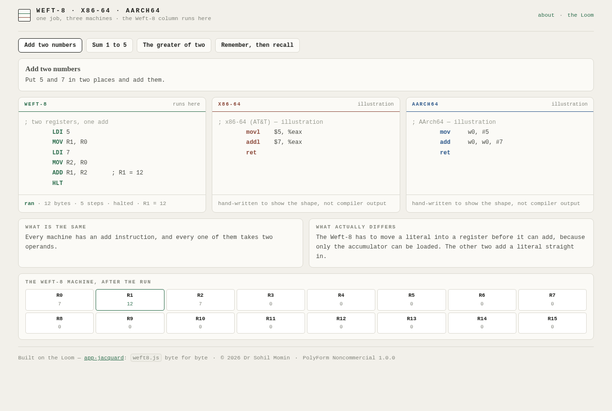

<div align="center">

# Weft-8 beside x86 and ARM

<!-- shot:start -->



<!-- shot:end -->

**Which part is the computer, and which part is the language?**

[](https://drsamonline.github.io/weft8-compare/)
[](https://github.com/drsamonline/weft8-compare/actions/workflows/test.yml)
[](https://github.com/drsamonline/weft8-compare/actions/workflows/build-apps.yml)
[](LICENSE)
[-2f5a8c?style=flat-square&labelColor=1e1f1c)](https://github.com/drsamonline/app-jacquard)

[**Open the three columns →**](https://drsamonline.github.io/weft8-compare/)

</div>


Five small jobs, written three times: for the **Weft-8** (the Loom's 8-bit machine), for **x86-64**, and
for **AArch64**. Put them side by side and the answer to "what is a computer, really?" stops being
abstract — load, add, compare, branch, store. Everything else is naming.

## The five jobs

| Job | What it shows |
|---|---|
| **Add two numbers** | the Weft-8 must move a literal into a register first; the other two add one straight in |
| **Sum 1 to 5** | x86 does it in two instructions, ARM in one, the Weft-8 in three — `SUB` sets flags but cannot branch |
| **The greater of two** | a compare, a conditional branch, two paths that converge. Identical shape on all three |
| **Remember, then recall** | the Weft-8 addresses memory with a literal byte; x86 and ARM compute an address from a frame or stack pointer |
| **Multiply by four** | two shifts here, one wide instruction there — the same idea in a wider instruction |

## Honest about the columns

The **Weft-8 column is executable**. The page runs it on the real machine, shows the registers afterwards,
and the test suite asserts the result of every one of the four jobs.

The **x86-64 and AArch64 columns are hand-written illustrations** — short, accurate in shape, and labelled
as illustrations in the page and in the data. They are not compiler output, and they do not claim to be.
A listing that pretends to be compiled when it was typed by hand would be exactly the sort of thing this
whole estate exists to avoid.

## Built on the Loom

The Weft-8 column is `docs/play/weft8.js` from
[Jacquard (the Loom)](https://github.com/drsamonline/app-jacquard) — byte for byte the same engine, the
same one its 102 assertions cover.

## Run it

Open `docs/index.html`, or the [live columns](https://drsamonline.github.io/weft8-compare/).

## Test it

```
npm install
node test-node.js          # 65 assertions — the four jobs and the honesty of the columns
node tests/page-smoke.js   # 9 assertions — the page, driven in jsdom
```

The suite asserts that every Weft-8 listing assembles, halts, fits the 128-byte ROM and leaves the
expected register or memory value; that every job says what it is, what the machines share and what
actually differs; and that **both illustration columns say they are illustrations** and contain real
mnemonics rather than a comment pretending to be code.


## The Weft-8 family

One machine, seven faces. Every one of these runs `weft8.js` from the Loom, byte for byte —
learn it once and you have learned all seven.

| | what it is |
|---|---|
| [the Loom](https://drsamonline.github.io/app-jacquard/) | the machine and its editor — where it all starts |
| [Weft Puzzles](https://drsamonline.github.io/app-weft-puzzles/) | five puzzles solved in assembly, a robot on a grid |
| [Clip Loom](https://drsamonline.github.io/app-clip-loom/) | clipboard programs you can read: strip, squeeze, wrap |
| [Weft-8 on hardware](https://drsamonline.github.io/weft8-hardware/) | the same machine in C, three-way parity with the JS one |
| [weft8-kit](https://drsamonline.github.io/weft8-kit/) | rules small enough to sign off |
| [Weft-8 Classroom](https://drsamonline.github.io/weft8-classroom/) | eight exercises that teach how a computer works |
| **Weft-8 beside x86 and ARM** (you are here) | the same four jobs in three machines |

<!-- support:sweep -->
## Support

| | |
|---|---|
| UPI (India) | `drsohilboi@ybl` — payee Dr Sohil Momin, open amount, or scan [the QR](docs/assets/upi-qr.svg) |
| GitHub Sponsors | [github.com/sponsors/drsamonline](https://github.com/sponsors/drsamonline) |
| Ko-fi | [ko-fi.com/matneo](https://ko-fi.com/matneo) |
| PayPal | [paypal.me/drsohilmomin](https://paypal.me/drsohilmomin?locale.x=en_GB&country.x=IN) |
| My books | [Amazon author store](https://www.amazon.com/stores/author/B08ZT331LY/allbooks?ccs_id=aed72b9f-71d9-41dc-adee-e9368a317acc) |
| More apps | [drsamonline.github.io](https://drsamonline.github.io/) |
| Email | [sohilmomin2000@gmail.com](mailto:sohilmomin2000@gmail.com) |

## Licence

**PolyForm Noncommercial 1.0.0** · © 2026 Dr Sohil Momin. Free for any noncommercial purpose.
